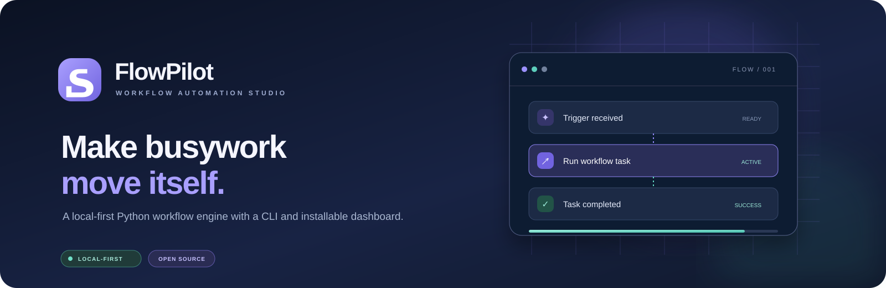

<div align="center">



**A local-first Python workflow automation engine with a command-line interface and an installable, responsive dashboard.**

[Quick start](#-quick-start) · [Dashboard](#-dashboard) · [Features](#-features) · [Security](#-security) · [Roadmap](#-roadmap)


</div>

# FlowPilot

FlowPilot helps you define repeatable tasks as validated JSON workflows, then run them from a CLI or a clean local web dashboard. Both interfaces use the same Python execution engine.

> **Project status: Alpha.** The current built-in task is `print`. The dashboard can create, validate, list, and run workflows, but this is not yet a general-purpose automation platform or a native Windows installer.

## ✨ Features

- **Local-first dashboard:** polished dark interface with responsive desktop and mobile layouts.
- **App-style experience:** web app manifest, branded icons, and a cacheable dashboard shell.
- **CLI:** serve the dashboard, list workflows, validate definitions, and run workflows.
- **Shared engine:** dashboard-created JSON workflows use the same engine as CLI workflows.
- **Validation:** checks workflow structure, step names, task types, and retry values.
- **Execution results:** reports per-step success, attempts, duration, and errors.
- **Safe starter task:** built-in `print` task; workflow files do not run arbitrary shell commands or Python source.
- **No runtime dependencies:** core engine and local HTTP server use the Python standard library.

## 🖥️ Dashboard

The dashboard is served locally by FlowPilot. It includes an overview, workflow builder, and saved workflow library.


### Run the dashboard

```bash
python -m pip install -e .
flowpilot serve
```

Open **http://127.0.0.1:8765**.

On supported browsers, you can use the browser's install option to add the dashboard as an app-style shortcut. The local Python server must still be running for workflow data and execution. Offline caching applies to the app shell, not workflow execution.

## 📦 Download source ZIP

- [Download the latest main-branch ZIP](https://github.com/chotamalik10/flowpilot/archive/refs/heads/main.zip)
- [Browse all source files](https://github.com/chotamalik10/flowpilot)

The ZIP is source code, not a prebuilt Windows `.exe`.

## 🚀 Quick start

**Requirements:** Python 3.10 or newer.

```bash
git clone https://github.com/chotamalik10/flowpilot.git
cd flowpilot
python -m venv .venv
```

Activate the environment:

**Windows PowerShell**
```powershell
.venv\Scripts\Activate.ps1
```

**macOS / Linux**
```bash
source .venv/bin/activate
```

Install the project and development tools:

```bash
python -m pip install -e ".[dev]"
```

## ⌨️ CLI

```bash
flowpilot --help
flowpilot serve
flowpilot list
flowpilot validate examples/hello.json
flowpilot run examples/hello.json
flowpilot run examples/hello.json --verbose
```

You can also run it without the installed entry point:

```bash
python -m flowpilot serve
python -m flowpilot run examples/hello.json
```

## 🧩 Workflow format

```json
{
  "name": "hello-world",
  "steps": [
    {
      "name": "welcome",
      "type": "print",
      "message": "Hello from FlowPilot!",
      "retries": 0
    }
  ]
}
```

Each step needs a unique name and a registered task type. The starter `print` task accepts a string `message`. Retries are configured per step.

## 🗂️ Project structure

```text
flowpilot/
├── assets/
│   └── flowpilot-banner.svg
├── .github/workflows/ci.yml
├── examples/
├── flowpilot/
│   ├── dashboard/
│   │   ├── icons/
│   │   ├── index.html
│   │   ├── styles.css
│   │   ├── app.js
│   │   ├── manifest.webmanifest
│   │   └── service-worker.js
│   ├── cli.py
│   ├── engine.py
│   ├── server.py
│   ├── models.py
│   ├── tasks.py
│   └── workflow.py
├── tests/
├── workflows/
├── LICENSE
└── pyproject.toml
```

## 🔒 Security

- The dashboard binds to `127.0.0.1` / `localhost`; non-local bind addresses are rejected.
- Request bodies are limited to 256 KB.
- Workflow filenames are validated before file access.
- Workflow definitions select registered task types; they do not execute arbitrary shell commands or Python source.
- The local dashboard has no authentication. Keep it on your own device and do not expose it directly to a public network.

## 🧪 Development and tests

```bash
python -m pip install -e ".[dev]"
pytest
ruff check .
```

GitHub Actions checks the test suite and Ruff lint across Python 3.10, 3.11, 3.12, and 3.13.

## 🗺️ Roadmap

- [x] Shared workflow engine and CLI
- [x] JSON workflow validation and retry support
- [x] Responsive local dashboard and workflow creation / execution
- [x] Installable web-app shell, manifest, and icons
- [x] Branded project banner and setup documentation
- [ ] File organizer task with preview / dry-run
- [ ] Persistent execution history
- [ ] Scheduling and recurring workflows
- [ ] Plugin system and custom task registration
- [ ] YAML workflow support

## 📄 License

MIT. See [LICENSE](LICENSE).
